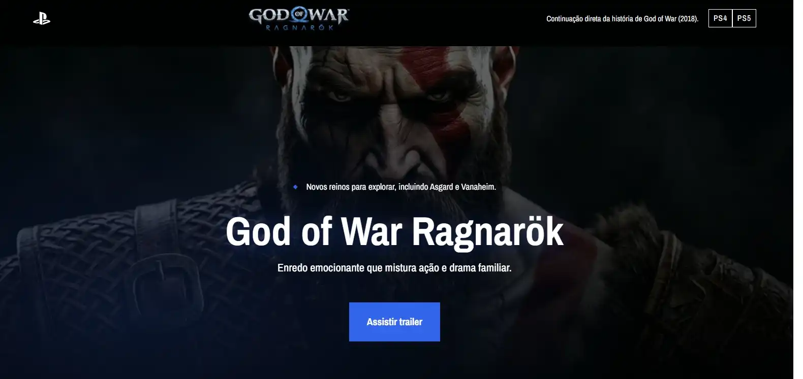

# ⚔️ God of War Ragnarök — Landing Page

Landing page temática inspirada em **God of War Ragnarök**, desenvolvida com HTML, CSS e JavaScript, contando com carrossel interativo de personagens e animações de rolagem.



## ✨ Seções e Funcionalidades

- **Cabeçalho (`<header>`):** Exibe os logotipos da Sony e de *God of War Ragnarök*, além da indicação de continuação de *God of War (2018)* e plataformas **PS4** e **PS5**.
- **Hero (`s-hero`):** Apresenta o título principal, chamada sobre os nove reinos (incluindo Asgard e Vanaheim) e atalho para a seção de trailer.
- **Trailer (`s-trailer`):** Destaque para o trailer oficial no YouTube (`https://www.youtube.com/watch?v=k6MP7S3Utco&t=11s`), thumbnail animada e aviso de classificação indicativa (18 anos).
- **Informações Gerais (`s-info-geral`):** Lista de recursos e destaques como jogo desconectado, campanha única, suporte remoto, vibração, gatilho adaptativo e suporte de ajuda.
- **História (`s-story`):** Resumo da jornada de Kratos e Atreus durante o Fimbulwinter e referência ao **Santa Monica Studio**.
- **Personagens (`s-character`):** Apresentação da premissa e carrossel **Swiper** com cards de personagens (**Kratos**, **Atreus**, **Mimir**, **Freya**, **Thor**, **Týr**, **Odin** e **Brok**), paginação por pontos, autoplay a cada 4 segundos e links externos para vídeos de aprofundamento.
- **A Trajetória de Kratos (`s-lenda`):** Seção dedicada à origem e evolução do personagem com link para vídeo complementar.
- **Rodapé (`rodape`):** Direitos autorais e botão de rolagem suave para o topo da página.
- **Animações de Scroll (`ScrollReveal`):** Efeitos de entrada configurados em `script.js` para elementos como `.left`, `.right a`, `.kratos-atreus`, `.machado`, `.text` e `.kratos-lenda`.

## 🛠️ Tecnologias Utilizadas

- **HTML5** (`index.html` com meta tags de SEO, Open Graph, Twitter Cards e múltiplos favicons)
- **CSS3** (`css/geral.css`, `css/header.css`, `css/hero.css`, `css/section.css`, `css/footer.css`, `css/responsive.css` e `Swiper` CSS via CDN)
- **JavaScript** (`script.js` para configuração do carrossel e animações)
- **Bibliotecas via CDN:**
  - [Swiper v12](https://swiperjs.com/)
  - [ScrollReveal v4](https://scrollrevealjs.org/)
  - Google Fonts (`Archivo Narrow`)

## 📁 Estrutura de Arquivos (conforme o código enviado)

```text
├── assets/
│   ├── __MACOSX/
│   │   └── img/._.DS_Store
│   └── img/
│       ├── favicon-package/
│       ├── icones/
│       └── personagem/
├── css/
│   ├── footer.css
│   ├── geral.css
│   ├── header.css
│   ├── hero.css
│   ├── responsive.css
│   └── section.css
├── index.html
└── script.js